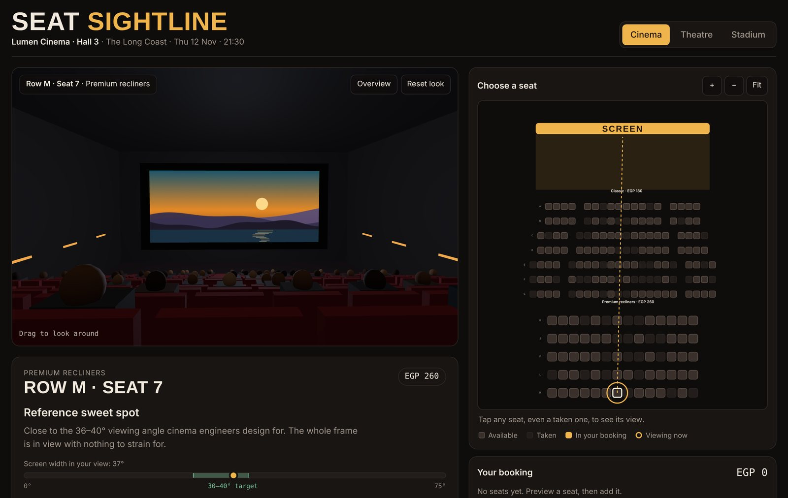
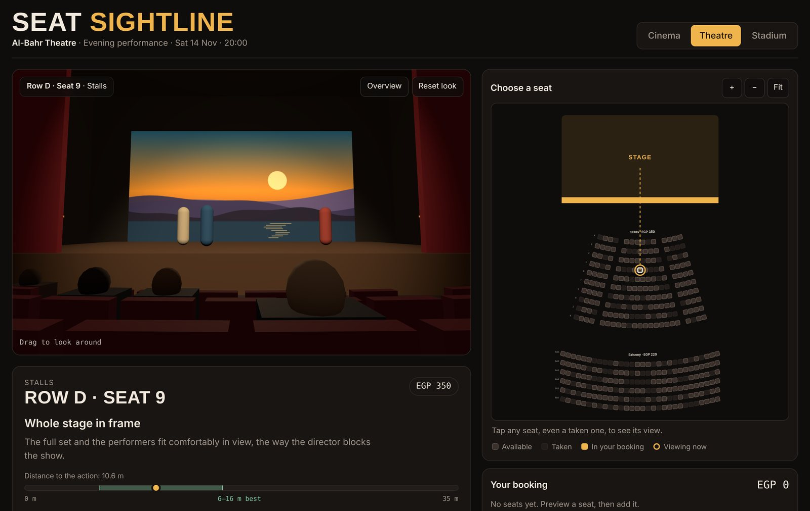
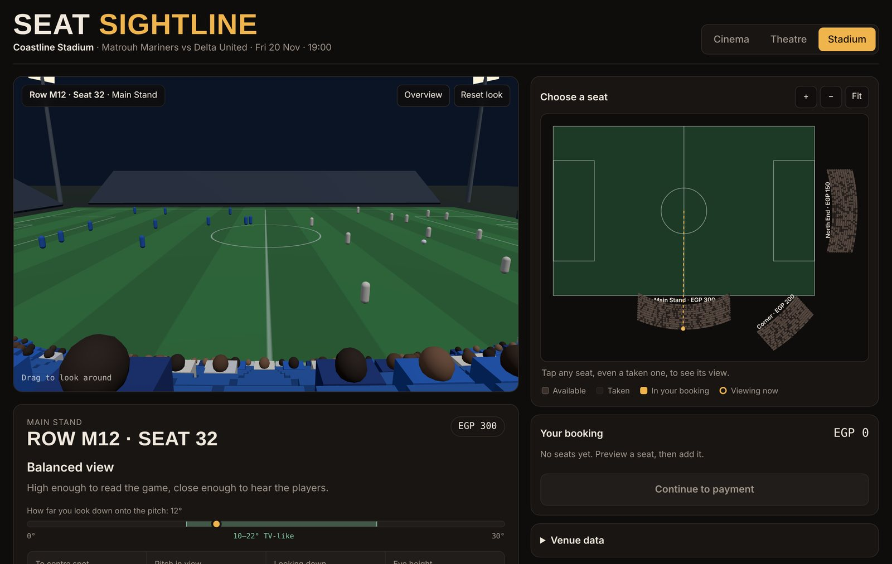
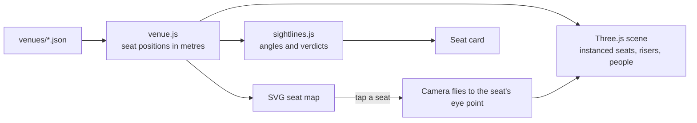

# Seat Sightline

**See the view from your seat before you book.** Pick a seat on the map and the camera flies into a live 3D view from that exact spot. Every seat also gets a plain verdict, like *Reference sweet spot*, backed by numbers: distance, viewing angle, head tilt and how far off-centre you sit.

One engine works for any venue. Each cinema, theatre, stadium or microbus is a single JSON file.

**[Live demo →](https://salahalshafey.github.io/seat-sightline/)**



| Theatre | Stadium |
|---|---|
|  |  |

## Features

- **First-person 3D preview** from any seat, including taken ones. Drag to look around, and use *Overview* to see the whole hall.
- **Real sightlines:** other people sit in the taken seats, so you can see whether the head in front blocks your view. The card also warns you about it.
- **Seat verdicts based on the numbers.** Cinemas use the 30–40° screen viewing angle that cinema guidelines recommend (SMPTE, THX). Theatres use distance to the stage. Stadiums use how steeply you look down onto the pitch. Microbuses use how much of the road ahead you can see past the headrests and heads in front (seeing the road helps against car sickness), plus legroom, the rear axle and the sliding door.
- **Vehicles from the inside:** the microbus has a driver at the wheel with two passenger seats beside them, a folding seat by the sliding door, curtains, roof AC ducts, and the coastal road moving past the windows.
- **Booking flow:** add or remove seats and see a running total. The demo stops before payment.
- **Data-driven venues:** edit the JSON in the *Venue data* panel and the map and 3D scene rebuild at once.
- **Works on phones and desktop:** zoom buttons and mouse-wheel zoom, drag to pan the map, and keyboard navigation (arrow keys plus Enter).
- **No build step:** plain HTML, CSS and ES modules. [Three.js](https://threejs.org) is loaded from a CDN.

## How it works



1. **Seats get real coordinates.** `venue.js` turns each section's rows into seats with an `x, y, z` position and a facing direction. The focus (screen, stage front or pitch centre) sits at the origin, the audience is on +z, and y is up.
2. **The same seats feed the map and the 3D scene.** The map draws them top-down in SVG. The scene draws them with `InstancedMesh`, so thousands of seats render in a handful of draw calls.
3. **The camera sits where your eyes would be,** 1.18 m above the seat floor, and looks at the focus target.
4. **The numbers are simple geometry.** For example, the screen's angle in your view is the 3D angle between your eye→left edge and your eye→right edge. Obstruction is checked by testing whether any seated head comes within 12 cm of the line from your eye to the bottom of the screen or stage.

## Add your own venue

Copy one of the files in [`venues/`](venues) and change it. Everything is in metres.

```json
{
  "name": "My Hall",
  "subtitle": "Opening night · Fri 4 Dec · 20:00",
  "currency": "EGP",
  "indoor": true,
  "focus": { "type": "screen", "width": 12.5, "height": 5.3, "bottom": 1.8 },
  "sections": [
    { "name": "Classic", "price": 180, "layout": "straight",
      "rows": 7, "firstDist": 5, "rowDepth": 1.05, "rise": 0.3, "startY": 0,
      "seats": [18, 18, 20, 20, 22, 22, 22], "aisle": 4, "seatWidth": 0.56 }
  ]
}
```

| Field | Meaning |
|---|---|
| `focus.type` | `screen`, `stage`, `pitch` or `road` (the inside of a vehicle) |
| `focus` (screen) | `width`, `height`, `bottom` (height of the screen's lower edge) |
| `focus` (stage) | `width`, `depth`, `height` (stage deck height) |
| `focus` (pitch) | `length`, `width` |
| `focus` (road) | `width` and `height` of the cabin inside, `windscreenBottom`, `windscreenTop`, and optional `rearAxle`, `doorFrom`, `doorTo` (z positions, measured back from the windscreen) |
| `indoor` | `false` draws an open-air ground and sky instead of walls |
| `layout` | `straight` rows, or `arc` rows curved around a centre point |
| `arcCenter` | z position of the arc's centre (for example `-12` puts it behind the stage) |
| `angle` | which side of the focus the section sits on, in degrees. `0` is in front and `90` is to the right |
| `rows`, `firstDist`, `rowDepth` | number of rows, distance of the first row from the focus, and depth of each row |
| `rise`, `startY` | how much each row steps up (the rake), and the floor height of the first row |
| `seats` | seats per row: one number for every row, or a list with one number per row |
| `pattern` | instead of `seats`: each row spelled left to right, for example `"D_SS"`. `S` seat, `F` folding seat, `D` driver (never for sale), `_` gap. One string for every row, or a list with one per row |
| `aisleWidth` | width of each `_` gap in a `pattern` (defaults to `seatWidth`) |
| `aisle` | number of seats from each end before an aisle gap. `0` means no aisle |
| `seatWidth` | seat pitch along the row |
| `rowPrefix` | optional row names such as `BA1`, `BA2`. Without it, rows are lettered A, B, C… |
| `seatColor` | optional seat colour in 3D |

To add the venue as a tab, put the file in `venues/`, add a button with a matching `data-v` to the tab list in `index.html`, and add the key to the allowed list near the end of `src/main.js`. You can also link straight to a venue with `?venue=theatre`.

## Run locally

ES modules and `fetch` don't work from `file://`, so serve the folder:

```bash
git clone https://github.com/salahalshafey/seat-sightline.git
cd seat-sightline
python3 -m http.server 8000      # or: npx serve .
# python -m http.server 8000
```

Then open <http://localhost:8000>.

<!-- ## Deploy to GitHub Pages

1. Push this repository to GitHub.
2. Go to **Settings → Pages**.
3. Under **Build and deployment**, choose **Deploy from a branch**, select `main` and `/ (root)`, then click **Save**.
4. After a minute the site is live at `https://YOUR-USERNAME.github.io/seat-sightline/`. Put that link in the README and in the repo's **About** box.

The empty `.nojekyll` file tells Pages to serve the files as they are. -->

## Project structure

```
seat-sightline/
├── index.html          page shell, import map for three.js
├── src/
│   ├── main.js         3D scene, camera, seat map, card and booking UI
│   ├── venue.js        venue JSON → seats with positions, plus validation
│   ├── sightlines.js   viewing-angle maths and verdict wording
│   └── styles.css
├── venues/             one JSON file per venue
│   ├── cinema.json
│   ├── theatre.json
│   ├── stadium.json
│   └── microbus.json
└── docs/               README screenshots
```

## Roadmap ideas

- Load a real venue model (`.glb` made in Blender) instead of the generated shapes.
- Live seat availability from a booking API, with temporary seat holds.
- Gyroscope look-around on phones.
- Compare two seats side by side.
- Photo-real venues from a phone scan (Gaussian splatting).

## Credits

- Inspired by a cinema booking concept shared by Ramin Nasibov on X.
- 3D rendering by [three.js](https://threejs.org) (MIT). Fonts: Big Shoulders Display and IBM Plex, from Google Fonts.
- All venue names, events and prices in the demo are made up.

## License

[MIT](LICENSE) © 2026 Salah Alshahfey
